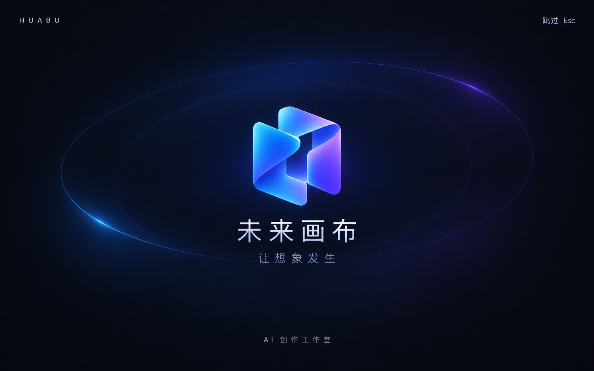

# 桌面开屏动画

macOS 与 Windows 冷启动显示品牌标志、双层细轨道和「未来画布 / 让想象发生」，标志淡入并轻微缩放，随后整层淡出到工作区。总动画 1.2 秒，可点击「跳过」或按 Esc 立即退出。动画在主应用挂载时播放一次，切换页面、主题或账号不会重播；初始或播放中启用系统减少动态效果即跳过，本次运行不再重播。iOS、Android、Linux 与 Web 不播放。

首页、路由与账号在下层照常加载，启动层消失不会重新挂载 Navigator，不增加网络等待、登录重试或图片解码门槛，不展示虚构进度。图片读取失败使用现有 Lucide 图标，仍按原动画退出。macOS 原生窗口与 Flutter View 初始化底色一致，Windows 沿用首帧完成后显示窗口的机制。

- 实现：`lib/app/desktop_launch.dart`。
- 接入：`lib/app/app.dart` 的 `MaterialApp.router` builder。
- 动效与主要尺寸：`lib/core/theme.dart` 的 `AppMotion`、`AppTheme`。
- 运行素材：`assets/branding/desktop-launch-mark.png`，已由现有 branding 资源目录打包，保留真实透明通道。
- 视觉参考：`design/desktop-launch-reference.png`，仅作设计参考，不将整张参考图放进运行界面或资源包。



本轮按用户要求进行本地预览：macOS Release 已编译成功，原生浅色开屏自动进入首页并加载真实图片；已修复 `Semantics.explicitChildNodes` 断言和首帧 Esc 焦点抢占。13 项开屏 Widget 测试通过，覆盖 Mac/Windows 时序、真实 Forui 快捷键恢复、Esc/点击跳过、减少动画、不重播、非桌面、720×480 和卸载；模拟平台不等于 Windows 原生验收。

包含焦点修复的最终 macOS Release 编译成功（120.9 MB），最终静态分析无问题，最终构建的原生深色开屏自动进入首页已实际核对。Cmd/Ctrl+K 恢复只完成 Widget 验证，未作原生键盘实测。Windows 原生编译、操作系统级减少动态效果、明暗偏好、首帧/缩放、Tab/焦点、图片失败与慢网络仍需验收，完整清单见待测试文档。本轮不改版本、不打发行包或发布。

## 生成方式与完整提示词

使用 Codex 内置 `image_gen` 图片工具，未使用 CLI。两次均以 `assets/branding/app-icon.png` 为输入参考；现有应用图标未被覆盖。第一张生成开屏设计参考，第二张生成动画实际使用的透明标志。

### 开屏参考图

输出 `design/desktop-launch-reference.png`，不透明背景。

```text
Use case: ui-mockup. Asset type: one production-quality desktop application launch-screen reference for 未来画布, an AI creative studio on macOS and Windows. Image 1 is the existing app icon, a brand-identity reference: preserve this original folded blue-violet canvas mark, do not invent a new logo. Create a single flat, straight-on 16:10 widescreen splash screen, no device or browser mockup. Background deep ink #0B0D14 with large quiet negative space. Center a compact crisp version of the supplied blue-violet glass ribbon logo, floating without a visible square icon plate. Around the mark, two extremely delicate large elliptical orbital contours and restrained cyan/violet ambient light, suggesting a canvas opening; no busy particles or galaxies. Below the logo, elegant readable Chinese typography with exact title '未来画布', then exact smaller subtitle '让想象发生'. Small top-left branding 'HUABU', small top-right functional label '跳过  Esc', discreet footer 'AI 创作工作室'. Premium understated desktop software launch design, precise alignment, restrained soft illumination, clear hierarchy, refined subtle glass planes, current blue #3788FF / violet #7958FF palette. The centered logo-and-type group occupies less than 32 percent of canvas height. No progress bar, no percentage, no fake loading status, no feature cards, no extra copy, no window frame, no photographic scene, no watermarks. This is a reference frame for a short native Flutter fade-in and gentle expansion animation, so keep the composition reproducible with an existing logo asset, text, radial gradients and simple thin ellipses.
```

### 透明标志

输出 `assets/branding/desktop-launch-mark.png`，工具启用透明背景。

```text
Use case: background-extraction. Edit the attached existing 未来画布 application icon into a standalone transparent mark for the desktop launch animation. Preserve the exact original folded canvas/ribbon silhouette and orientation, cyan-blue-violet gradients, smooth materials and edge highlights. Remove only the deep navy square backdrop and any rectangular icon plate. The entire exterior must be genuinely alpha transparent, with clean antialiased edges; also make the negative space inside the folded mark transparent wherever there is no physical ribbon. Keep the original logo identity; no new logo, no redesign, no extra objects, no text, no shadow plate, no ground, no frame, no circular badge, no watermark. Center the same isolated mark at about 78 percent of a square canvas, with safe margins. This transparent PNG will be composited onto both pale and deep-ink Flutter launch backgrounds, so do not bake black or white around its edges.
```
